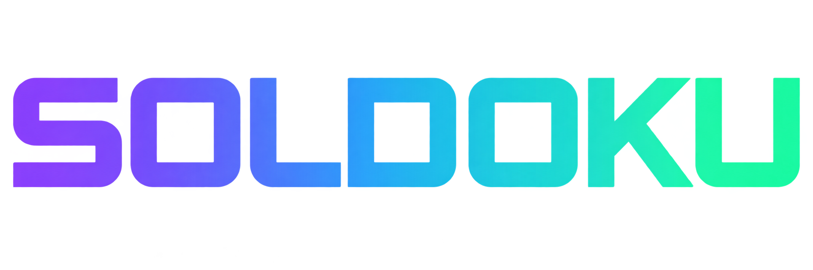

<div align="center">



# Soldoku

### One grid. Your fastest finish.

Sudoku for quiet solo play, friendly races, and wallet-connected competitions on Solana.

[Play Soldoku](https://soldoku.com) · [Demo guide](submission/demo-script.md) · [Verification evidence](docs/evidence)

</div>

---

## A familiar game, a shared challenge

Soldoku brings competitive Sudoku into a simple mobile and browser experience. Players solve the same grid, record a verified finish, and see where they rank. Start with a solo puzzle, race a friend without a wallet, or enter a leaderboard competition.

The goal is a usable game first: clear rules, readable results, and recoverable wallet actions. Solana adds escrow and verifiable payouts to funded competitions.

## Choose how to play

| Mode | Experience | Wallet |
| --- | --- | --- |
| **Classic** | Solve at your own pace; pause and continue your saved game. | None |
| **Practice** | Race a friend on the same grid. | None |
| **Free competition** | Join a shared leaderboard, then start your timed attempt. | Message authorization |
| **Funded competition** | Deposit an equal stake into escrow; compete for the pool. | Signed transactions |

**Devnet beta · Soldoku tokens have no cash value.** New funded rooms and deposits are currently paused; existing claims, refunds, and settlement remain available. Card execution is disabled. Mainnet and real-money play are not enabled.

## Try the demo

1. Open **[soldoku.com](https://soldoku.com)** and choose Classic to play immediately.
2. Choose Practice to create a free race and share its room code.
3. Choose Compete to explore leaderboard rooms. Connect a compatible wallet, authorize the message, and press **Start challenge** when ready.
4. Finish the puzzle to see your recorded time and ranking.

On a Seeker, Soldoku connects through Mobile Wallet Adapter and Seed Vault Wallet. Desktop browsers use compatible Wallet Standard wallets. Funded testing requires a wallet configured for the app's network; wallet connection and message authorization do not deposit a stake.

The Android package is a web shell that loads the hosted app. Website releases therefore update the experience without rebuilding the APK. The APK and signing keys are not distributed through this README.

## Competition flow

**Registration → escrow deposit → shared puzzle → verified result → settlement → claim or refund**

Players choose a preset or custom stake when creating a room. The amount is fixed for that room. Confirmed entrants start together when registration closes. The unique fastest valid finish wins the pool; exact fastest ties or no valid finishes refund entrants. A solo entrant can reclaim their stake when registration closes. A settlement deadline provides a further refund path.

Players sign with their own wallets. The Worker prepares and validates transactions, checks results, and runs scheduled settlement; the Solana program holds the tokens in escrow. Puzzle verification and settlement authority are server responsibilities, so this is not a fully trustless competition system.

Signed transaction receipts are saved before submission. An uncertain response is reconciled against chain state before a replacement is signed. Claims and refunds remain available while new funded entry is paused.

## What has been demonstrated

| Journey | Evidence |
| --- | --- |
| Physical Seeker connection, message authorization, free play, and return | [Device evidence](docs/evidence/2026-10-09-seeker/) |
| Physical funded deposits, winner journey, and payout | [Funded device tests](docs/evidence/2026-10-09-seeker-relay-fixed-physical/) |
| Scheduled settlement and retained confirmation receipt | [Scheduled round](docs/evidence/2026-10-09-scheduled-devnet/) |
| Recovery of an actual stuck Seeker receipt without clearing storage | [Recovery report](docs/evidence/2026-10-10-pending-recovery-deploy/REPORT.md) |
| Extended-room refund: wallet +1 Soldoku, vault empty, finalized | [DAABEC94 refund](docs/evidence/2026-10-11-daabec94-refund/REPORT.md) |

Evidence records the release and conditions tested. These results demonstrate the tested flows; they do not establish general production security or unattended reliability.

## Architecture

| Layer | Role |
| --- | --- |
| React + TypeScript | Game, competition screens, wallet flow, and receipt recovery |
| Cloudflare Worker + D1 | Room state, result verification, transaction validation, and settlement cron |
| Solana competition escrow | Stakes, competition deadlines, winner claims, and refunds |
| Android web shell | Hosted app with Mobile Wallet Adapter handoff |

The current multiplayer competition code lives in `src/competition/`. Historical two-player race code remains in the repository; it is distinct from the current leaderboard escrow flow.

Card-funding foundations separate provider payment, asset delivery, and escrow entry. A future provider could fund a supported Solana asset before a player signs their entry. Provider execution and public simulation are disabled; this is architecture groundwork, not a working checkout.

## Run locally

Use the Node version in `.nvmrc` and install the locked dependencies:

```sh
npm ci
npm run dev
```

Validate a change:

```sh
npm test
npm run build
```

The latest copy change passed **316 tests**, with **6 opt-in integration tests skipped**, and a TypeScript/Vite build. Skipped tests are not verified results. Local development does not authorize deployment or enable payments.

For Android setup, see [`android/`](android/) and [private setup instructions](docs/PRIVATE_SETUP.md). Keep wallet keys, signing credentials, and provider secrets outside the repository.

## Release and operations

The hosted version is identified by [`/api/release`](https://soldoku.com/api/release). GitHub main can include changes that have not been deployed. The public Worker configuration is `wrangler.soldoku.jsonc`.

- [Deployment and financial-state recovery](docs/deploy-devnet.md)
- [Free competition pilot guide](docs/pilot/FREE-COMPETITION-PILOT.md)
- [Card-funding architecture](docs/adr/0001-card-funding-foundations.md)
- [Submission materials](submission/)

Remaining work includes dependency security findings, a live D1 restore rehearsal, stronger solver/collusion resistance, and external payment-provider approval. The Worker funding pause does not freeze direct on-chain joins. These limits must be addressed before broader financial operation.

## Built by Alice

Created and maintained by **[Alice Arcade · alicearcadeth](https://github.com/alicearcadeth)**.

For judges: use the live app, demo guide, source, and dated evidence together. Submission acceptance and store publication are separate from the verified product flows above.
